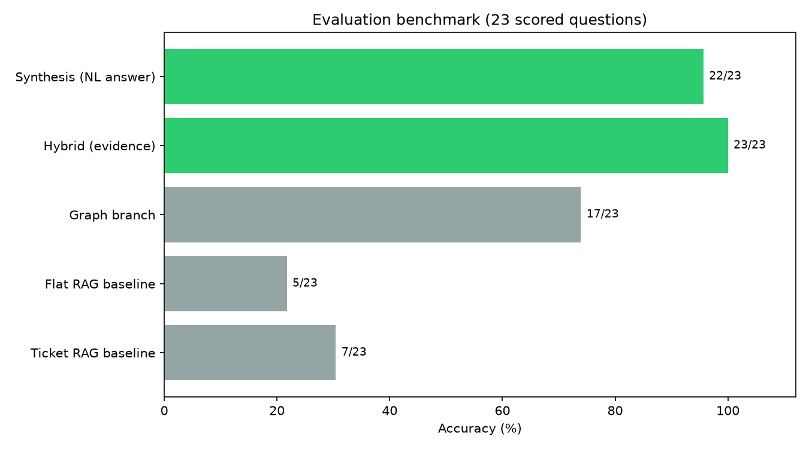

# Enterprise Knowledge Graph Agent

A hybrid question-answering prototype over Order-to-Cash data: a Neo4j graph for structured orders and customers, a Chroma vector index for support tickets, and an LLM that routes each question and generates read-only Cypher.
It is a research demo, not a production service.

**Tech stack:** Neo4j, ChromaDB, FastAPI, Anthropic Claude, pytest.

## Results

| Metric | Value |
|---|---:|
| Synthesized answer accuracy | **22/23** |
| Evidence retrieved correctly | **23/23** |
| Routing accuracy | **23/23** |
| Ground truth independently verified | **25/25** |
| Graph loaded (nodes / relationships) | **1,198 / 3,385** |
| Latency, avg (GRAPH / TICKETS / BOTH) | **9.2s / 6.3s / 7.5s** |



Source: `eval/evaluation_report.json`, `eval/ground_truth_report.json`, `data/*.csv`.

## Example questions

Verified against `eval/evaluation_set.json` and `eval/ground_truth_report.json`.

| Route | Question | Verified answer |
|---|---|---|
| GRAPH | How many orders has customer ALFKI placed? | 6 orders |
| TICKETS | Which tickets mention damaged products? | 38 tickets |
| BOTH | Did customer SAVEA file any support tickets mentioning carrier delays? | Yes, 1 ticket |
| GRAPH | What is the CEO's email address? | Refuses: no such field in the graph or tickets |

## How it works

```
data --> Neo4j (graph) + Chroma (tickets) --> orchestrator --> FastAPI /ask
```

- A classifier call picks GRAPH, TICKETS, or BOTH; the matching branch runs, never all three.
- Cypher is generated by the LLM, then validated as read-only before it ever reaches Neo4j.
- Synthesis sees only the retrieved evidence and must say so when that evidence is insufficient.

## Data

| Source | Rows | Loaded as |
|---|---:|---|
| customers.csv | 91 | `Customer` nodes |
| orders.csv | 830 | `Order` nodes, `PLACED` relationships |
| products.csv | 77 | `Product` nodes |
| order-details.csv | 2,155 | `CONTAINS` relationships |
| support_tickets.json (synthetic) | 200 | `SupportTicket` nodes, `FILED`/`REFERENCES` relationships |

Northwind is public sample data; tickets are synthetic, generated by `data/generate_support_tickets.py` from five templates against real customer and order ids.

## Evaluation

23 scored questions (`eval/evaluation_report.json`, `eval/ablation_report.json`), each checked against evidence pulled from graph rows and/or retrieved ticket text.

| System | Correct | What it measures |
|---|---:|---|
| **Synthesis (what the user reads)** | **22/23** | The final natural-language answer |
| Hybrid evidence | 23/23 | Graph plus ticket text contains the answer |
| Graph branch alone | 17/23 | Graph results alone contain the answer |
| Ticket branch alone | 5/23 | Ticket text alone contains the answer |
| Flat RAG baseline | 5/23 | One sentence per order, no graph |
| Ticket RAG baseline | 7/23 | Full ticket search, no graph |

| Comparison | Delta |
|---|---:|
| Graph vs flat RAG | +12 questions (17 vs 5) |
| Graph vs ticket RAG | +10 net (17 vs 7): graph right on 14 that ticket RAG missed, ticket RAG right on 4 that graph missed |
| Hybrid vs graph alone | +6 questions (23 vs 17) |

## Ticket retrieval

| Query type | n | MRR | Recall@3 |
|---|---:|---:|---:|
| Narrow (exact order/ticket) | 3 | 0.833 | 0.889 |
| Theme (broad topic) | 5 | 1.000 | 0.076 |

Source: `eval/rag_retrieval_report.json`. A narrow query about order 10864 does not reliably rank its ticket first; that one case is marked `xfail` in `tests/test_rag_retrieval_eval.py`.

## Safety

- All LLM-generated Cypher is checked in `agent/cypher_safety.py`: write keywords are rejected and a result limit is enforced before anything reaches Neo4j.
- `agent/synthesis.py` declines to answer when the retrieved evidence does not support the question, rather than guessing.
- Ticket text is treated as untrusted content; embedded instructions inside a ticket body are ignored, not followed.
- The `/ask` endpoint sanitizes internal errors: no stack traces, credentials, or file paths reach the client.

## Latency

Local run, sequential requests, 3 runs per question, 9 completed, 0 failed.

| Route | Avg (ms) | Median (ms) | p95 (ms) |
|---|---:|---:|---:|
| GRAPH | 9,235 | 6,468 | 14,195 |
| TICKETS | 6,334 | 3,860 | 10,785 |
| BOTH | 7,473 | 7,542 | 7,645 |

Source: `eval/latency_benchmark_report.json`. Most of this time is the Anthropic API round-trips, not Neo4j or Chroma, which stay under a second.

## How to run

```bash
python -m venv venv && source venv/bin/activate
pip install -r requirements.txt
cp .env.example .env   # set NEO4J_PASSWORD and ANTHROPIC_API_KEY
python graph/load_graph.py
python rag/build_index.py
uvicorn api.main:app --reload
curl -X POST http://127.0.0.1:8000/ask -H 'Content-Type: application/json' \
  -d '{"text": "How many orders has customer ALFKI placed?"}'
pytest   # tests needing Neo4j, an API key, or chroma_db skip cleanly without them
```

## Limitations

- No API authentication; this is a local demo, not a hardened service.
- A synthesis guard catches zero counts for two unloaded labels (Employee, Invoice) but not for an unknown customer or order id, which can read as a real zero instead of a refusal.
- Ticket retrieval for a single exact order number is unreliable; the graph is the dependable path for that.
- Grading is substring and refusal matching, not semantic comparison, over 23 questions, too small for statistical claims.
- Neo4j Community Edition has no read-only database role, so write protection is enforced in application code, not the database.

## License

MIT, see [LICENSE](LICENSE).
